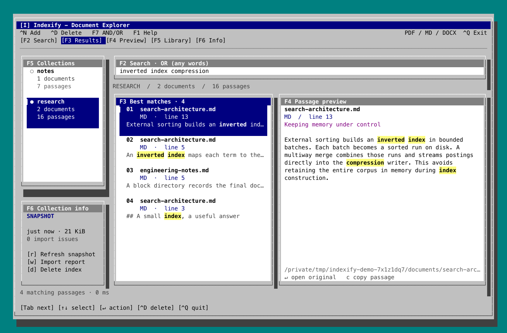
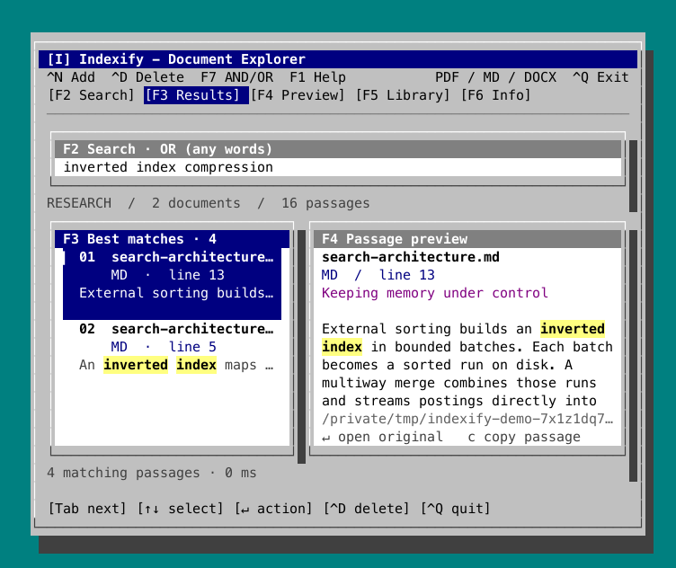

# Indexify

Make a document—or a directory full of documents—searchable from your terminal.
PDF, Markdown, and Word (`.docx`). Local text extraction, ranked passage search,
and a Windows 95 inspired Ratatui interface: teal desktop, silver beveled windows,
navy title bars, white document panes, and yellow search highlights. Collections,
passage previews, and keyboard navigation stay close at hand. No account, server,
or model is required.

## Install

### Homebrew

With [Homebrew](https://brew.sh) installed, run:

```sh
brew install arrxy/tap/indexify
indexify --version
```

Homebrew automatically adds the `arrxy/tap` tap and makes the `indexify` command
available on your PATH. The formula builds from source and installs the required
Rust build tools automatically.

To update an existing installation:

```sh
brew update
brew upgrade arrxy/tap/indexify
```

### From source

With a current Rust toolchain installed:

```sh
git clone https://github.com/arrxy/indexify.git
cd indexify
cargo install --path . --locked
```

## Quick start

Replace the example paths with your own document or directory:

```sh
# Index a directory recursively and open the interface.
indexify ~/Documents/papers --name papers

# Or index one document.
indexify ~/Documents/report.pdf --name report

# Open an existing collection later.
indexify browse papers
```

Type a few keywords and press **Enter** to search. **F7 / Ctrl+O** switches
between OR (any word) and AND (all words). Use **F2–F6** to jump between panels,
**Ctrl+N** to add a collection, and **Ctrl+Q** to exit. The full keyboard reference
is below.

The first positional argument is the source path. Collection names are optional
and default to the filename or directory name. Names accept letters, numbers,
hyphens and underscores. Existing names require an explicit refresh; an import
never silently replaces a collection. For a path containing spaces, use quotes
and `$HOME`:

```sh
indexify "$HOME/Documents/My Papers" --name papers
```

## Screenshots

Screenshots of the actual Ratatui interface, using the bundled example notes.

**Wide terminal:** collections, ranked results, source locations, and highlighted
passage previews in the Windows 95 inspired theme.



<details>
<summary>Compact terminal layout</summary>

The collection sidebar moves into a picker on smaller terminals. **F5** opens
Collections, and **F6** opens Collection info.



</details>

To try the same example notes from a source checkout:

```sh
indexify ./examples/documents --name research
```

## Search and manage collections

```sh
indexify browse research
indexify search research "inverted index compression"
indexify search research "inverted index" --mode and
indexify search research "compression" --json
indexify list
indexify refresh research
indexify remove research
```

`remove` deletes only the collection's generated index and text snapshots. It
never deletes source documents. Directory imports are recursive. Hidden
directories, symlinks, Word lock files, and unsupported extensions are skipped.
Extensions are case-insensitive. Individual extraction failures are reported
and excluded; other files continue to import. Use **w** outside the search
field to inspect a collection's report.

For scripts or a terminal without an interactive TTY:

```sh
indexify ./documents --name research --no-ui
indexify refresh research --no-ui
```

## Keyboard

| Key | Action |
| --- | --- |
| F1 | Open keyboard help from any panel, including search |
| F2 / Ctrl+F | Jump to Search |
| F3 / Ctrl+E | Jump to Results |
| F4 / Ctrl+P | Jump to Preview |
| F5 / Ctrl+L | Jump to Collections |
| F6 / Ctrl+G | Jump to Collection info |
| `/` | Focus search (outside text fields) |
| Enter in search | Run query and focus results |
| Tab / Shift+Tab | Cycle all five panels, including Collection info |
| Up/Down or j/k | Select result/collection, or scroll focused preview |
| Enter on a result | Open the original document in the system viewer |
| Enter on a collection | Load it |
| Up/Down + Enter in Collection info | Select and run Refresh, Import report, or Delete index |
| Ctrl+D | Open Delete index confirmation from any panel |
| d / Delete outside search | Delete the chosen index; Delete key works in Collections and Collection info |
| F7 / Ctrl+O | Toggle OR (any word) / AND (all words); rerun the current query |
| c | Copy the selected passage |
| Ctrl+N or a | Add a document or directory |
| r | Rebuild the active collection from its original path |
| w | Show import report |
| ? | Show help |
| Esc | Leave search or close a dialog |
| Ctrl+Q / Ctrl+C | Quit; cancel safely during import |

Single-letter shortcuts apply outside text fields. On Linux, copying uses
`wl-copy` or `xclip`; macOS uses `pbcopy`, Windows uses `clip.exe`. Opening uses
the system default application. Page/line/paragraph references are displayed
in the interface; opening a specific location depends on the viewer and is
not currently automated.

Delete confirmation starts on **Cancel**. Use Tab or the left/right arrows to
choose **Delete index**, then Enter; Esc cancels. Deletion removes the generated
index, extracted snapshots and collection metadata. Source PDF, MD and DOCX
documents remain in place. In Collections and Collection info, actions apply to
the highlighted collection; in the other panels, they apply to the loaded one.
Close any other sessions using that collection before deleting it. The app
releases its own reader, recovers the current search session if deletion is
blocked, and loads the next collection after a successful deletion.

The layout shows a collection sidebar and side-by-side results/preview on wide
terminals. Smaller terminals hide the sidebar; narrow terminals stack the
panes. Ctrl+L opens a collection selector when the sidebar is hidden; use arrows
and Enter to switch, or run
`indexify browse <name>`. Minimum useful terminal size is 50 columns × 16 rows.

## What is indexed

| Format | Extraction | Source reference |
| --- | --- | --- |
| PDF | Selectable text, page by page | Page number |
| MD | UTF-8 Markdown text, including code blocks | Heading and paragraph-start line |
| DOCX | Main document paragraphs, runs, and table cells | Heading and paragraph number |

Long passages are split into windows of at most 180 words, with 24 words of
overlap. Short paragraphs remain separate. Word documents have no stable page
numbers without rendering, so paragraph references are used instead.

Scanned/image-only PDFs need OCR before indexing. Image-only pages in mixed
PDFs are not searchable. A PDF can also render normally while its embedded
text/font mapping is damaged or unsupported. Nonempty extracted text can still
be garbled; such a copy needs a repaired text layer or OCR for reliable search.
PDF layout extraction is best effort; complex columns,
font encodings, and reading order can affect results. DOCX headers, footers,
comments, embedded images, and tracked-change semantics are not interpreted.
Its main document XML is limited to 64 MiB. Markdown is indexed as source text,
without fetching linked content. PDF and DOCX are parsed one document at a
time; parsing a very large individual document can still use substantial RAM.

## Storage and refreshes

Collections default to `~/.local/share/indexify`, or `$XDG_DATA_HOME/indexify`
when that variable is set. Set `INDEXIFY_HOME` or use the global `--home` flag
to choose another location:

```sh
indexify --home ./my-library ./documents --name research --no-ui
indexify --home ./my-library search research "indexing"
```

Each collection stores an immutable text snapshot, source metadata, and the
compressed search index. Previews keep working when originals change or move.
Use `refresh` to reflect edits, additions and deletions in the source directory.
Refresh currently rebuilds the collection; it is not incremental or automatic.

Builds stage a new generation, then atomically replace a small `CURRENT`
pointer only after success. A failed or cancelled import preserves the previous
collection. Completed refreshes remove previous generations. Active readers
hold a shared filesystem lock; close other search sessions before refreshing
or removing that collection. The interface releases its own reader before a
refresh. Abrupt termination can leave an unpublished temporary directory, which
can be removed while the app is closed.

The existing Rust passage engine lives in `engine/`. Indexify reuses its external
sorting, parallel construction, compressed postings, block directories, and
exact BM25 top-ten retrieval. The dictionary, page table and passage-offset
array are resident; full passage text stays on disk. Each query scores all
matching candidates, so very common terms can be slower. Search supports any/all
word matching; it does not provide phrase, typo-tolerant or semantic search.

## Verify and preview

```sh
cargo test --workspace --locked
indexify preview research --query "inverted index" --output preview.svg
```

`preview` exports the actual Ratatui frame through its `TestBackend`. A companion
`.cells.json` file records its terminal cells. There is no separate web mockup.
Tests exercise real PDF/DOCX extraction, mixed directories, passage references,
Unicode, independent snapshots, failed refreshes, locks, cancellation, terminal
layouts, and the existing search-engine correctness suite.
